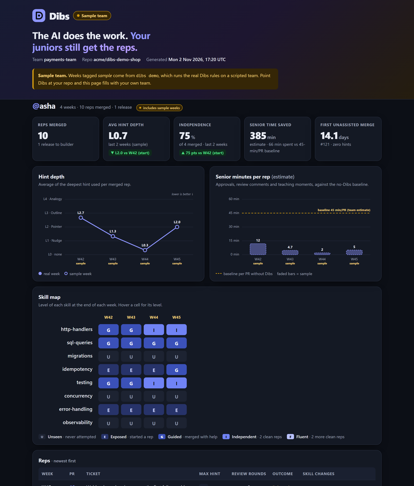
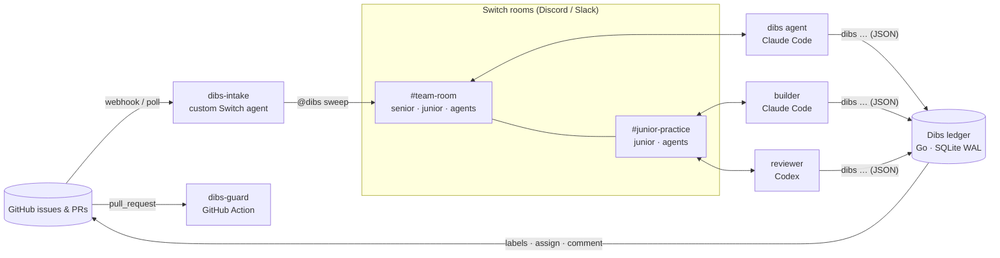

<div align="center">

# 🙋 Dibs

### Your AI teammates call dibs on the right work for your juniors.

**The AI does the work. Your juniors still get the reps.**

[](https://github.com/vivekyarra/dibs/actions/workflows/ci.yml)
[](go.mod)
[](https://github.com/sandbox-quantum/switch)
[](https://www.wemakedevs.org/hackathons/switch)
[](LICENSE)



</div>

```bash
go run github.com/vivekyarra/dibs/cmd/dibs@latest demo   # the whole story in 10 seconds, no setup
```

<p align="center"><a href="https://vivekyarra.github.io/dibs/"><b>Live dashboard</b></a> · <a href="https://github.com/vivekyarra/dibs-demo-shop/pull/12"><b>dibs-guard on a real PR</b></a> · <a href="https://github.com/vivekyarra/dibs/releases"><b>Download</b></a></p>

---

## The problem

Every team now has agents that can close an entry-level ticket in 20 minutes. So the junior never gets the 3-hour version, and that 3-hour version is how juniors become seniors.

- Employment for 22–25-year-olds in the most AI-exposed jobs, software development among them, fell **13%** relative to older workers (Stanford Digital Economy Lab, *Canaries in the Coal Mine*, 2025).
- AWS CEO Matt Garman called replacing juniors with AI *"the dumbest thing I've ever heard"*, because it breaks the pipeline that produces senior engineers.
- Mentoring still runs on senior time, the scarcest resource on the team. Most of it goes on first-pass guidance, not the moments that need a senior.

Every agent workflow today asks *how do humans hand work to agents?* Dibs asks the opposite: **which work should the agents hand back, so the team still has seniors in five years?**

## What Dibs does

Dibs is a Switch room for a software team. It runs Claude Code and Codex as teammates, a deterministic ledger that makes every decision, and a GitHub Action that enforces those decisions.

| | |
|---|---|
| 🙋 **Calls dibs on learning tickets** | Each new issue is scored against the junior's evidence-based skill map. Dibs picks the ticket just past what they can do: low blast radius, real deadline slack. The senior approves with one tap. Everything else goes to the builder agent. |
| 🪜 **Coaches without solving** | One room rule binds Claude Code *and* Codex: on a reserved ticket they give graded hints (L1 nudge → L4 analogy), never the answer. Deeper hints unlock only after honest attempts, and **code checks every hint before it is posted.** |
| 🛡️ **Enforces it on GitHub** | `dibs-guard` blocks any PR that closes a reserved ticket unless the junior wrote it. The rule holds even when someone tells an agent to "just fix it". |
| 🎓 **Spends senior time where it counts** | Codex runs a Socratic first-pass review. The senior is pinged only for flagged *teaching moments* (≈5 min each) and the final sign-off. |
| 📈 **Proves growth with evidence** | Every merged rep moves the skill map: Unseen → Exposed → Guided → Independent → Fluent. The map is a Switch room document only `dibs` can write. A weekly ramp report and dashboard track hint depth, independence and senior minutes saved. |
| ⏱️ **Never stalls delivery** | A learning budget caps reps per junior and share of backlog. If a deadline moves, Dibs releases the ticket to the builder, who finishes from the junior's branch and credits them. The junior gets a walkthrough. |
| 🤖 **Runs itself** | `dibs autopilot` polls GitHub, triages, scores, applies deadlines and posts into the Switch rooms on its own. The weekly report arrives every Monday. |

## See it work

These are real messages from `dibs demo`, which plays a team's week through the actual engine:

```text
#payments-team
🙋 DIBS for @asha → #3 POST /orders creates duplicates when the client retries: make it idempotent
   growth edge: idempotency (Exposed→Guided) · error-handling (Exposed)
   builder ≈30 min · asha ≈1.0h · slack 6.9 days · score 5.00
   budget: 1/1 rep slot(s) · backlog share 10% (cap 20%)
   @ravi approve with Allow, or reply `@dibs ok 3` / `@dibs no 3`
→ builder: #1 too easy · #2 little to learn · #4 risky (migrations/0002_partition.sql) · #5 too far · #7 too easy · …

#asha-practice   (the builder asks the ledger for an L3 hint)
Ledger: granted L1 — L3 is not unlocked yet; giving L1 (L2 after 1 more attempt(s) or in 15 min)
✋ refused (hint_violation): this L1 hint breaks the ladder; rewrite it (L1 allows no code; found 3 code line(s))
builder: What would the server need to remember if the same request arrived twice?

#payments-team
🛑 builder-bot opened pull/15, which closes #3, a rep reserved for @asha. `dibs-guard` will block it.
🎓 Teaching moment for @ravi on #3: Correct, but keys are stored forever (no TTL). Retention trade-offs. (≈5 min)
🏁 #3 merged · deepest hint L2 · 1 review round(s) · 3h20m
📈 idempotency Exposed→Guided
```

The full transcript, report and dashboard land in `./dibs-demo/`.

## Live on GitHub

Dibs ran end to end against a real repository, [`vivekyarra/dibs-demo-shop`](https://github.com/vivekyarra/dibs-demo-shop), with the same binary:

| Step | Real artifact |
|---|---|
| The sweep scores 10 real issues and picks **#3** as the rep; the senior approves | [Issue #3](https://github.com/vivekyarra/dibs-demo-shop/issues/3): `dibs:reserved:asha` and skill labels, the Dibs comment |
| The builder opens a real fix that closes #3, and **`dibs-guard` blocks it** | [PR #12](https://github.com/vivekyarra/dibs-demo-shop/pull/12) · [guard run, attempt 1: blocked](https://github.com/vivekyarra/dibs-demo-shop/actions/runs/42250427039/attempts/1) |
| The deadline moves; Dibs **releases** the rep, and the **same check passes** | [guard run, attempt 2: passed](https://github.com/vivekyarra/dibs-demo-shop/actions/runs/42250427039/attempts/2) · `dibs:released` on #3 |
| The PR merges; the ledger records the rep and queues the junior's walkthrough | #3 closed by PR #12 |
| The next sweep picks **#6** as the next rep | [Issue #6](https://github.com/vivekyarra/dibs-demo-shop/issues/6) |

The dashboard from `dibs demo` is published at **[vivekyarra.github.io/dibs](https://vivekyarra.github.io/dibs/)**.

## How it works



1. **Sweep.** The `dibs` agent reads new issues and proposes skills, an estimate and touched paths. The **ledger** scores them with fixed arithmetic (`@dibs why 3` shows the sum) and posts the card.
2. **Approve.** The senior presses **Allow** on Switch's native approval prompt. The ledger labels, assigns and comments on GitHub.
3. **Practice.** In the private practice room, every agent runs `dibs status` before helping and `dibs hint give` before posting. The ledger grants the level and checks the text: L1 has no code or file names and must ask a question; L2 has no code; L3 is at most 8 lines with ≤3 repo identifiers.
4. **Review.** Codex reviews Socratically and records the verdict. "Ready" pings the senior with rounds, hint depth and attempts.
5. **Record.** On merge, the ledger moves the skill map and the agent mirrors it into a Switch room document only it can edit.
6. **Release.** Deadline at risk, junior stuck with no answer, or proposal unanswered: the ledger hands the ticket to the builder with credit and a walkthrough.

**The model proposes, the ledger decides.** Agents deliver the ledger's messages verbatim; they never make a Dibs decision. That makes behaviour identical across vendors, testable and explainable.

## How Dibs uses Switch

| Switch feature | What Dibs does with it |
|---|---|
| **Rooms on Discord / Slack** | A team room and a private practice room per junior, in the chat app people already use |
| **Room instructions** | The *Dibs Protocol* binds every agent in the room, Claude Code and Codex alike, to one coaching rule |
| **Groups and room links** | `dibs-<team>` groups both rooms; the `practice` link tells agents which room belongs to whom |
| **Room documents with enforced authorship** | `skill-map-<junior>` and `dibs-ledger` are written only by `dibs`, which makes them tamper-evident records |
| **Native approval prompts** | `dibs approve` is an *ask* permission, so the senior's **Allow once** is the reservation sign-off, recorded by Switch |
| **Addressing rules** | Agents answer members of their rooms only; senior-only actions are verified again by the ledger |
| **Templates** | One import creates 3 agents, 2 rooms, the group, the link, aliases, the protocol document and kickoffs |
| **Agent protocol** | `dibs-intake` is a custom non-LLM agent that registers over the protocol and posts GitHub activity into the room |
| **Multiple vendors as teammates** | Claude Code builds and coordinates, Codex reviews, under the same rule |

Without Switch, Dibs has no room to put a rule in, no agent identities to hold to it, and no tamper-evident place for the evidence. Details: [docs/how-dibs-uses-switch.md](docs/how-dibs-uses-switch.md).

## Quick start

**1. See it** (no accounts, about 10 seconds):

```bash
go install github.com/vivekyarra/dibs/cmd/dibs@latest
dibs demo            # prints the story, writes dibs-demo/dashboard.html
```

**2. Run it with your team:**

1. Install [Switch Console](https://docs.switchagents.ai/switch-rooms/getting-started/install-switch-console.md), add a local server, and connect Discord or Slack.
2. In your repo, run `dibs scaffold --senior <login> --junior <login>` (it writes `.dibs/` with skills inferred from your code), then `dibs init`. Add the guard workflow:
   ```yaml
   # .github/workflows/dibs-guard.yml
   on: { pull_request: { types: [opened, edited, synchronize, reopened] } }
   permissions: { issues: read, pull-requests: read }
   jobs:
     guard:
       runs-on: ubuntu-latest
       steps:
         - uses: actions/checkout@v5
         - uses: vivekyarra/dibs@main
   ```
3. In Console → **Templates → Import**, paste [`switch/dibs.template.yaml`](switch/dibs.template.yaml) and press **Create all**. Three agents, two rooms and the protocol appear, and `@dibs` runs the first sweep.
4. Optional, for full autonomy: `dibs intake register` then `dibs autopilot`.

Full setup: [docs/setup.md](docs/setup.md). To try it on a ready-made codebase, [`examples/demo-shop`](examples/demo-shop) is a FastAPI service with 10 real issues; publish your own copy with `scripts/create_demo_repo.sh <you>/dibs-demo-shop`.

## Engineering

- **Deterministic core.** Every rule (scoring, hint ladder, skill ladder, releases, metrics) is a pure Go function in `internal/engine`, with unit, property and fuzz tests (98.7% coverage).
- **Safe under concurrent agents.** The SQLite ledger runs in WAL mode with immediate transactions and busy retries. Stress tests run 32 goroutines and 4 OS processes against one file with zero lost updates.
- **Hint text is checked by code.** `CheckHint` counts code lines (fenced and inline), file paths and repo identifiers read from the ticket's touched files. A refused hint is logged and must be rewritten.
- **Upstream-validated template.** CI lints `switch/dibs.template.yaml` with Switch's own `template_lint` at a pinned commit, and `dibs template --check` keeps it in sync with the agent instructions.
- **Production CI.** Tests with `-race` on Linux, macOS and Windows, golangci-lint (gosec, staticcheck, revive), govulncheck, a coverage gate, the offline demo as a smoke test, and the example service's pytest suite with strict-xfail tests that prove its bugs are real.
- **One static binary.** Pure Go with no CGO; GoReleaser builds for Linux, macOS and Windows on amd64 and arm64.

## Tech stack

| Layer | Choice |
|---|---|
| Ledger, CLI, guard, intake | Go 1.27, `modernc.org/sqlite` (pure Go), `gopkg.in/yaml.v3`, standard library |
| Agents | Claude Code (`dibs`, `builder`) and Codex (`reviewer`) via Switch Console |
| Team chat | Switch rooms on Discord (Slack, Teams, Mattermost, Telegram supported by Switch) |
| Enforcement | GitHub Action (`action.yml`), GitHub REST API |
| Dashboard | Server-rendered SVG, `html/template`, zero JavaScript |
| Example service | Python 3.12, FastAPI, pytest |

## Project structure

```text
cmd/dibs/            the dibs CLI (one binary: ledger, guard, intake, autopilot, demo)
internal/
  engine/            pure rules: scoring, hints, skills, releases, metrics
  ledger/            SQLite ledger and event log
  service/           operations, sync, autopilot
  tracker/           GitHub REST client and in-memory tracker
  guard/             dibs-guard GitHub Action
  intake/            Switch agent-protocol client and webhook relay
  report/            weekly report, skill map, HTML dashboard
  story/             the scripted team behind `dibs demo`
  tmpl/              builds the Switch template from agents/
agents/              Dibs Protocol and the three agents' instructions
switch/              dibs.template.yaml for Switch Console
examples/demo-shop/  FastAPI service with 10 real issues and a ready .dibs/
action.yml           dibs-guard as a reusable GitHub Action
docs/                architecture, Switch integration, setup
```

## Docs

- [Architecture](docs/architecture.md)
- [How Dibs uses Switch](docs/how-dibs-uses-switch.md)
- [Setup, intake and autopilot](docs/setup.md)

## Built by

[Vivek Yarra](https://github.com/vivekyarra) for **Flip the Switch** (WeMakeDevs × DevTools Academy × Switch), Track 01: Best Business Workflow. MIT licensed.
