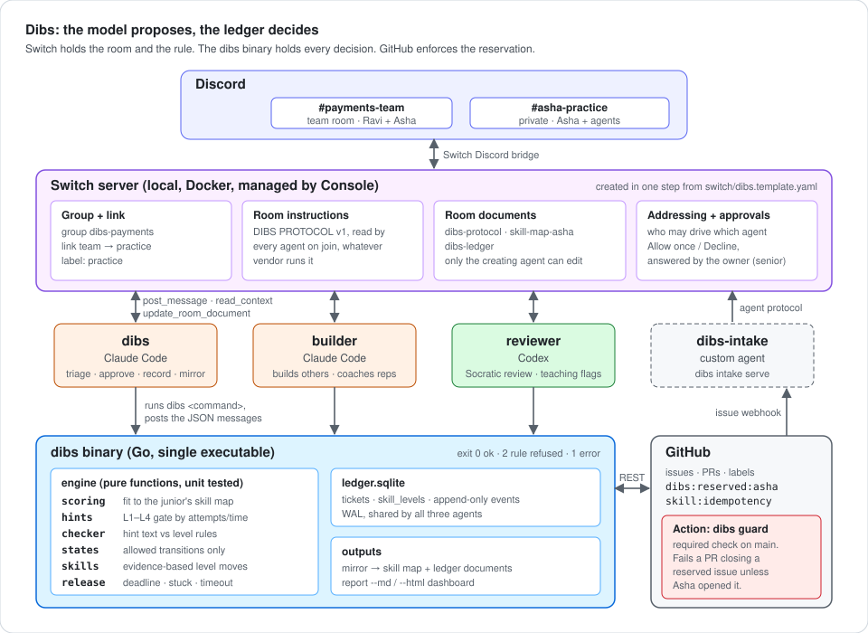
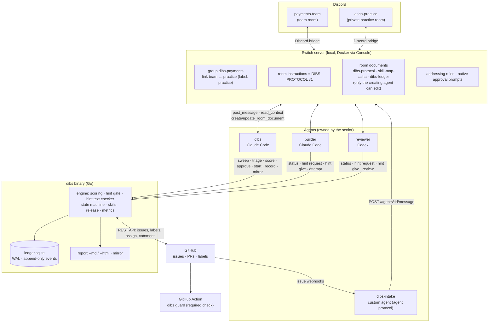

# Architecture

Dibs has four parts:

1. **Switch** holds the people, the agents, the rooms and the rules.
2. **Three LLM agents** (two Claude Code, one Codex) do the talking, the coding and the reviewing.
3. **The `dibs` binary** (Go, one static executable) holds every decision in a SQLite ledger.
4. **GitHub** holds the tickets, and a `dibs guard` check blocks anyone but the reserved junior from closing a reserved ticket.

The design rule: **the model proposes, the ledger decides.** Agents read issues and code and propose inputs (skill tags, an hour estimate, touched paths). The binary turns those inputs into decisions with pure, unit-tested functions. No agent can grant itself a deeper hint, reserve a ticket, or move a skill level.



## Diagram (Mermaid)



## Request flow: one hint

1. Asha types `@builder how do I make this idempotent?` in `#asha-practice` on Discord.
2. The Discord bridge delivers it to the Switch room. Switch wakes `builder`, which has already read the room instructions (the Dibs Protocol).
3. `builder` runs `dibs status 3`, sees `IN_PROGRESS`, and switches to coach mode.
4. `builder` runs `dibs hint request 3 --level 3 --agent builder`. The ledger has 0 attempts and 6 minutes elapsed, so it grants **L1** and returns `next_unlock: "L2 after 1 more attempt(s) or in 14 min"`.
5. `builder` writes an L1 hint to a file and runs `dibs hint give 3 --level 1 --agent builder --text-file hint.md`. The binary checks the text: no code, no file names, at least one question. If it fails, the command exits `2` with the violations, and the agent rewrites the hint.
6. On success the command returns JSON with `messages`. The agent posts them verbatim.

The same path runs for `reviewer` on Codex. Nothing in it depends on which vendor runs the agent.

## Components

| Component | Tech | Responsibility |
|---|---|---|
| Switch server + Console | Switch 0.31.x, Docker, Console desktop app | Rooms, Discord bridge, agent identities, room instructions, room documents, approvals, history |
| `dibs` | Claude Code agent | Triage, reservations, practice-room briefs, evidence, mirrors, reports. Never writes product code. |
| `builder` | Claude Code agent | Implements non-reserved tickets. Coaches on reserved ones. |
| `reviewer` | Codex agent | Reviews every PR. Socratic on reserved ones. Flags at most 2 teaching moments per PR. |
| `dibs-intake` | `dibs intake register\|serve\|send`, Switch agent protocol | Turns GitHub issue webhooks into team-room messages that wake `@dibs` |
| `dibs` binary | Go, pure-Go SQLite (`modernc.org/sqlite`), no cgo | The ledger and every rule. Every command prints JSON with a `messages` array. |
| Ledger | SQLite file at `~/.dibs/<owner>__<repo>.sqlite` (override with `DIBS_DB`) | Tickets, skill levels, and an append-only `events` table |
| Tracker | `internal/tracker`: GitHub REST, or an in-memory tracker | GitHub for live runs; the in-memory tracker powers `dibs demo` and the tests |
| `dibs guard` | GitHub Action running the same binary | Fails any PR that closes a reserved issue unless the author is the reserved junior |
| Dashboard | `dibs report --html F` | One static page: hint depth over weeks, skill heatmap, senior minutes vs baseline, reps table |

## Code layout

| Path | What it holds |
|---|---|
| `cmd/dibs/` | CLI entry point and command wiring |
| `internal/engine/` | Pure functions: `scoring.go`, `hints.go` (gate and text checker), `states.go`, `skills.go`, `release.go`, `metrics.go`, plus `engine_test.go` |
| `internal/ledger/` | SQLite access, transactions, `schema.sql` |
| `internal/service/` | Commands as transactions over the ledger; builds the chat `messages` |
| `internal/tracker/` | `Tracker` interface, GitHub REST client, in-memory tracker |
| `internal/config/` | Loads and validates `.dibs/team.yaml`, `skills.yaml`, `dibs.yaml` |
| `internal/guard/` | The PR check |
| `internal/intake/` | The custom Switch agent |
| `internal/report/` | Markdown report and HTML dashboard |
| `internal/story/` | The scripted team story behind `dibs demo` |
| `internal/tmpl/` | Builds and checks `switch/dibs.template.yaml` (`dibs template --check`) |

## Why these choices

**One Go binary.** Three agents on two vendors all need to call the same rules. A single executable with no runtime to install (`go install` or a release download) is the smallest thing every agent's shell can run. Pure-Go SQLite means no C toolchain on Windows.

**One shared SQLite file.** All agents run on one machine through Console, so a shared file is the simplest consistent ledger. Writes use WAL mode and immediate transactions so two agents calling at once don't corrupt state. A multi-machine setup would put the binary behind a small HTTP API; that is out of scope for the hackathon.

**JSON out, chat text included.** Every command returns `messages`, the exact text the agent should post and the room to post it in. The agent delivers; the binary words it. That keeps numbers, levels and reasons identical across vendors and across retries.

**Exit codes carry meaning.** `0` is ok. `2` is "a rule refused this" with a JSON `reason` (for example, a junior trying to approve their own reservation, or an L1 hint that contains a file name). `1` is a real error. Agents are told to treat `2` as an answer, not a failure.

**Switch documents as the public record.** After any state change, `dibs mirror` emits markdown for `skill-map-<junior>` and `dibs-ledger`. The `dibs` agent pushes it with `create_room_document` the first time and `update_room_document` after. Switch only lets the creating agent change a document, so the junior, `builder` and `reviewer` cannot edit the skill map. The ledger is the source of truth; the document is a tamper-evident view of it in the room where people already look.

**A hard guard on GitHub.** The protocol is followed by LLMs, and LLMs make mistakes. `dibs guard` runs as a required check, so a leaked solution still can't close the ticket unless the reserved junior opens the PR.

## Ticket states

```
NEW → TRIAGED → PROPOSED → RESERVED → IN_PROGRESS → JUNIOR_PR_OPEN → SENIOR_SIGNOFF → MERGED → EVIDENCE_RECORDED
          │           │
          └───────────┴──→ TO_BUILDER → BUILDER_PR → MERGED

RESERVED / IN_PROGRESS / JUNIOR_PR_OPEN ──release──→ RELEASED → TO_BUILDER
```

Any transition not in this graph is rejected by `internal/engine/states.go`.

## Offline path

`dibs demo [--out DIR]` runs the full story (sweep, approval, hints, attempts, guard, review, merge, release, report) against the in-memory tracker with a fixed clock, then writes the dashboard. It needs no Switch, no Discord and no GitHub token. It is the fastest way to check that the rules do what this document says.
